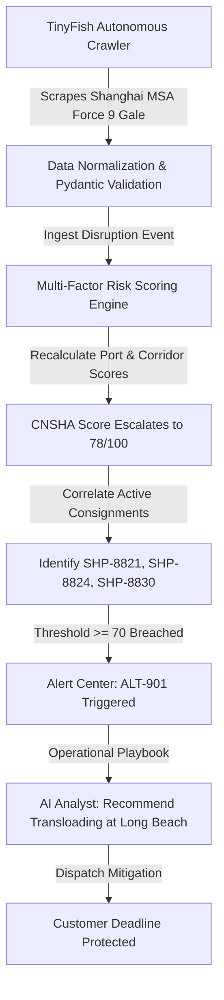

# NEXUS — Supply Chain Intelligence Platform

> **Predict disruptions. Protect deliveries. Act before delays happen.**

NEXUS is an enterprise-grade AI-powered supply chain disruption prediction platform designed for modern logistics control towers. By continuously monitoring maritime weather hazards, port berth dwell latencies, carrier blank sailings, labor strikes, and geopolitical chokepoint diversions, NEXUS identifies vulnerabilities days before they affect delivery deadlines.

---

## 1. Core Differentiators

- **Autonomous Browser Automation (TinyFish)**: Crawls live port authority safety broadcasts (e.g. Shanghai MSA, Port of Rotterdam Portbase, Maersk schedule bulletins), parses dynamic DOM structures, and validates extracted notices against Pydantic schemas.
- **Rules-Based Predictive Risk Scoring**: Multi-factor model with normalized inputs (0–100 scale), user-configurable weights, 3-tier forecast horizons (24h / 72h / 7d), and deep "Why this risk?" explainability diagnostics.
- **Shipment-Specific SLA Impact Correlation**: Cross-references disrupted maritime corridors with active consignments, predicting delay ranges and calculating financial contract penalty exposure.
- **Grounded AI Logistics Analyst**: Conversational intelligence interface grounded in actual application state, offering structured findings, SLA breach diagnoses, and alternative routing benchmarks.
- **Interactive Global Shipping Radar**: MapLibre/Leaflet map with CartoDB Dark Matter tiles, geodesic trade lanes, risk-coded port markers with pulsing alert halos, and simulated vessel tracking.

---

## 2. Complete Workflow Demonstration



---

## 3. Technology Stack

| Layer | Technologies |
|---|---|
| **Frontend** | Next.js 16 (App Router), React 19, TypeScript |
| **Styling** | Tailwind CSS v4, Lucide Icons, Material Symbols, Glassmorphism Surfaces |
| **Interactive Map** | Google Maps Platform (`@vis.gl/react-google-maps`) + Leaflet / CartoDB Fallback Radar |
| **Visualizations** | Recharts (Multi-line Trends, Bar Charts, Donut Risk Profiles) |
| **Backend** | Python 3.10+, FastAPI, Uvicorn |
| **Data Validation** | Pydantic v2 |
| **Browser Agents & Web Research** | Official TinyFish Python SDK v0.9.0 (`tinyfish`) |
| **Persistence** | Lightweight File-Persisted & In-Memory Store (`nexus_data_store.json`) |
| **Testing** | Pytest Test Suite |

---

## 4. Platform Navigation & Pages

1. **Supply Chain Control Tower (Dashboard)**:
   - 6 Key Performance Indicator cards with trend vectors (Monitored Shipments, At-Risk Shipments, Active Disruptions, High-Risk Ports, Predicted Delays, Financial Exposure).
   - Global interactive shipping radar with layer toggles (Ports, Routes, Hotspots, Vessels).
   - Risk overview panel with distribution bars and compact 7-day risk trend chart.
   - Chronological disruption feed with category filters (Weather, Congestion, Geopolitics, Carrier).
   - Active shipment risk table with column sorting, status badges, and quick inspect actions.

2. **Risk Intelligence**:
   - Interactive weight calibration sliders (Weather, Port Congestion, Carrier Schedule, Labour Strike, Geopolitical).
   - 3-tier forecast horizons (Next 24h, 72h, 7 days).
   - "Why this risk?" explainability breakdown detailing confirmed vs inferred signals.

3. **Shipments Register**:
   - Consignment register with search, filtering by carrier, status, and risk level.
   - Manual shipment creation modal with instant validation.
   - CSV bulk import with column validation and error reporting.
   - CSV export functionality.
   - Detailed shipment inspector modal with milestone journey timeline and mitigation playbooks.

4. **Ports & Routes**:
   - Port telemetry cards for Shanghai, Rotterdam, Singapore, Los Angeles, Hamburg, and Jebel Ali.
   - Berth wait hours, weather indices, and active port notices.
   - Corridor alternatives comparison (e.g. Oakland rail bypass vs Incheon Air-Sea Express).

5. **Alert Center**:
   - Incident queue with active severity badges.
   - Interactive status lifecycle: **Acknowledge**, **Resolve**, and **Dismiss**.
   - Source evidence traceability and affected shipment links.

6. **AI Analyst**:
   - Conversational supply chain intelligence interface.
   - Suggested prompts: *"Which shipments are most at risk this week?"*, *"Why is Shanghai showing elevated risk?"*, *"What alternatives should I investigate for this route?"*.
   - Structured markdown answers with bulleted findings and follow-up chips.

7. **Agent Center (TinyFish)**:
   - Configured logistics sources (Shanghai MSA, Port of Rotterdam Portbase, Maersk Customer Advisories, POLA Signal, Suez Transit Authority).
   - Live **"Run Agent Now"** trigger with real-time console log streaming.
   - Audit history of extracted observations and downstream triggers.

8. **Analytics**:
   - Recharts visual dashboards for 7-day port risk trends, berth dwell hours by hub, disruption category distribution, and agent reliability metrics.

9. **Settings**:
   - Threshold sliders for High (>=70) and Medium (>=40) alert triggers.
   - API key management for TinyFish and LLM providers.
   - Synchronization cadence controls.
   - Demo dataset reset button.

---

## 5. Quick Start & Local Development

### Prerequisites
- Node.js v18+ and npm
- Python 3.10+ and pip

### Installation & Execution

#### Option A: Universal One-Command Launcher (Recommended)
Launches both the FastAPI backend and Next.js frontend concurrently in a single terminal. Works seamlessly across Windows, macOS, and Linux without OS script permission blocks:

```bash
python run.py
```

- **Frontend Dashboard:** [http://localhost:3000](http://localhost:3000)
- **FastAPI Interactive Docs:** [http://127.0.0.1:8000/docs](http://127.0.0.1:8000/docs)
- **Stop Both Servers:** Press `Ctrl + C` in the terminal.

---

#### Option B: PowerShell & Batch Scripts
- **PowerShell**:
  ```powershell
  .\run_dev.ps1
  # If PowerShell blocks script execution:
  powershell -ExecutionPolicy Bypass -File .\run_dev.ps1
  ```
- **Windows Batch / Double-Click**:
  ```cmd
  run_dev.bat
  ```
  *(Note: If Windows SmartScreen displays an access denied warning on cloned `.bat` files, run `Unblock-File .\run_dev.bat` in PowerShell or right-click `run_dev.bat` → Properties → check **Unblock**).*

---

#### Option C: Manual Startup (Separate Terminals)

**1. Backend (FastAPI)**
```bash
# Windows
python -m venv backend/venv
backend\venv\Scripts\pip install -r backend/requirements.txt
backend\venv\Scripts\python -m uvicorn main:app --app-dir backend --host 127.0.0.1 --port 8000 --reload

# macOS / Linux
python3 -m venv backend/venv
source backend/venv/bin/activate
pip install -r backend/requirements.txt
python -m uvicorn main:app --app-dir backend --host 127.0.0.1 --port 8000 --reload
```

**2. Frontend (Next.js)**
```bash
cd frontend
npm install
npm run dev -- -p 3000
```

---

### Zero-Config Evaluation Mode (No API Keys Required)
NEXUS is designed to run cleanly for evaluators and reviewers without requiring external API keys:
- **Google Maps Platform**: If `NEXT_PUBLIC_GOOGLE_MAPS_API_KEY` is not present, the application automatically activates the built-in Leaflet / CartoDB maritime radar map with interactive port markers, routes, and vessel tracking.
- **TinyFish Web Research**: If `TINYFISH_API_KEY` is not configured, the research workspace operates in **Simulation Mode**, generating realistic, schema-validated maritime advisories with source citations.
- **Optional Live Keys**: To connect live cloud services, copy the template files and insert your keys:
  - `backend/.env` → `TINYFISH_API_KEY=your_key`
  - `frontend/.env.local` → `NEXT_PUBLIC_GOOGLE_MAPS_API_KEY=your_key`

---

## 6. Running Tests

Run the backend pytest suite verifying data validation, the risk scoring engine, TinyFish integration, and the AI analyst:

```powershell
$env:PYTHONPATH="backend"
backend\venv\Scripts\python -m pytest backend/tests/test_backend.py -v
```

All 6 test cases cover:
- Pydantic model validation
- Port risk score normalization & formula weighting
- Shipment risk score & delay hour calculation
- Full system recalculation & automatic alert generation
- TinyFish browser crawler simulation & observation pipeline
- Data-grounded AI Analyst inquiry responses

---

## 7. TinyFish Autonomous Web Research Architecture

NEXUS integrates the official **TinyFish Python SDK** (`v0.9.0`) per official agent documentation (`https://docs.tinyfish.ai/for-coding-agents`):

1. **Server-Side Credential Isolation**: `TINYFISH_API_KEY` is managed in `backend/.env` (never exposed to browser bundles, network payloads, or logs).
2. **Live Web Intelligence & Crawler Telemetry**: Real-time extraction of port authority safety broadcasts, maritime weather advisories, and carrier blank sailing notices.
3. **Evidence Normalization Schema**: Formats results into structured records containing source URL, publication date, retrieval timestamp, location, disruption severity, verbatim excerpt, and verification classification (`SOURCED_FACT`, `ANALYTICAL_INFERENCE`, `UNVERIFIED_CLAIM`).
4. **Interactive Dedicated Workspace**: Built at `/research` with live crawler phase animations, context selectors (port, corridor, carrier, disruption category), and persisted research history.

---

## 8. Google Maps Platform Integration

NEXUS features the official **Google Maps Platform Maps JavaScript API** using its supported React integration (`@vis.gl/react-google-maps`):

1. **Light-Theme Maritime Cartography**: Styled with custom vector palette matching the NEXUS Stitch design tokens (`#DBEAFE` ocean water, `#F8FAFC` landmass, suppressed road networks).
2. **Risk-Coded Port Markers**: Standard `Marker` implementation ensuring universal compatibility across demo and production keys without requiring a Cloud Map ID.
3. **Interactive InfoWindows**: Displays port name, country, UN/LOCODE, risk rating, berth dwell, weather index, and direct links to TinyFish research.
4. **Geodesic Shipping Corridors**: Polyline overlays color-coded by friction score, clearly labeled as illustrative shipping geometry and demo telemetry.
5. **Resilient Multi-Engine Fallback**: Automatically traps `window.gm_authFailure` and API loader errors (e.g. unactivated billing or quota limits), providing seamless fallback to the CartoDB / OpenStreetMap maritime layer so the platform never fails.

